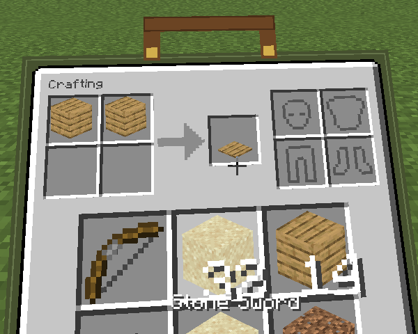

# HandsOn VR

Add-on para o [Vivecraft](https://modrinth.com/mod/vivecraft) (Minecraft 26.3, Fabric) que deixa o inventário com cara de jogo nativo de VR. O jogador mexe nos itens com as mãos, sem telas que o deixam parado.

- **Coldres físicos:** ombro direito e os dois quadris guardam qualquer item. Leve a mão ao coldre e segure o grip para sacar o item; solte o grip para guardá-lo de volta. Para guardar o item da mão, feche a mão nele (grip), leve-o ao coldre e solte.
- **Mochila no ombro esquerdo:** grip no ombro abre a mochila na mão, no estilo de *Saints & Sinners*. Ela tem 3 páginas de 3x3, crafting 2x2, armadura e uma zona de descarte. A outra mão pega, move, junta e descarta itens. Para guardar o item da mão, solte o grip **por cima do ombro esquerdo**, ou num espaço da mochila aberta.
- **Menu radial da hotbar:** segure B (mão direita) ou X (mão esquerda). A hotbar aparece em círculo, com a mão vazia no centro; leve a mão até um item e solte o botão.
- **Coleta na mochila:** o que você coleta do chão vai primeiro para o inventário principal (a mochila). A hotbar só recebe quando ele enche, então ela fica com o que você escolheu.
- **Arco na mão que o pegou:** pegue o arco com uma mão e a flecha aparece na outra. Encoste a flecha na corda, segure o gatilho, puxe e solte.
- **Mesa de trabalho imersiva:** com a mochila numa mão, ponha os itens na grade 3x3 em cima da mesa com a outra. Eles ficam deitados nas casas, o resultado flutua acima e pegar ele fabrica, com o item vindo para a mão.
- **Regra das mãos:**
  - O que você pega com o grip é emprestado: ao soltar, volta para o lugar.
  - O que você escolhe no radial fica na mão.
  - Isso funciona até com o inventário 100% cheio.



O design completo está em [docs/DESIGN.md](docs/DESIGN.md). O padrão visual (tudo com a cara do Minecraft) está em [docs/VISUAL.md](docs/VISUAL.md). O histórico de versões está no [CHANGELOG](CHANGELOG.md).

## Controles (Quest 2)

| Botão | Ação |
|---|---|
| Grip | Pegar (coldre, mochila, item da mochila ou do radial) enquanto estiver apertado. Em qualquer outro lugar, segura o item da própria mão. |
| Soltar o grip | Devolve o item ao lugar dele. Sobre um espaço da mochila, coloca ali; num coldre, guarda ali; no ombro esquerdo, guarda na mochila. |
| Gatilho com o grip apertado | Coloca um item por vez num espaço ou na zona de descarte. |
| B / X | Menu radial da hotbar da mão direita / esquerda. |
| Gatilho esquerdo | Usa o item da mão esquerda. |
| Analógico direito | Gira a câmera, como no Vivecraft. A hotbar fica com o menu radial (B/X). |

Tudo pode ser ligado e desligado em **Coldres VR**, no menu de pausa.

## Requisitos

| Componente | Versão |
|---|---|
| Minecraft | 26.3 |
| Fabric Loader | 0.20.1 ou superior |
| Fabric API | 0.166.2+26.3 |
| Vivecraft | 1.3.18 (Fabric, 26.3) |
| Java | 25 |

O mod só roda no cliente. Ele usa os cliques normais do inventário do Minecraft, então funciona em qualquer servidor.

## Compilar

O build usa o jar do Vivecraft, que não faz parte do repositório. Baixe o `vivecraft-26.3-1.3.18-fabric.jar` no Modrinth (ou copie da pasta `mods` do perfil) e coloque-o em `../libs/`, ou seja, numa pasta `libs/` ao lado da pasta do projeto. O nome precisa ser exatamente esse.

O Minecraft 26 exige Java 25, e o Loom precisa do Gradle rodando em Java 25. Se ele não estiver instalado, o Gradle baixa um para o próprio cache (`gradle/gradle-daemon-jvm.properties`), sem instalar nada no sistema. A 0.1.0 (Minecraft 1.21.1) continua no histórico do git.

```bash
./gradlew build
```

O jar sai em `build/libs/`.

## Testes automáticos (sem óculos)

```bash
./gradlew prodClient          # VR simulado: coldres, mochila, radial, inventário cheio, prints
./gradlew prodClientNullVr    # VR nulo do Vivecraft: ligação com grips, gatilhos, A, B e X
```

Os relatórios ficam em `run-prod/handsonvr-selftest.txt` e `run-prod-nullvr/handsonvr-selftest.txt`. Os prints ficam em `run-prod/screenshots/`.

Para testar dentro do modpack de verdade (Sodium, Iris, Vivecraft e o resto do Fabulously Optimized), aponte para a pasta `mods` do perfil. O HandsOn do perfil e o Essential ficam de fora:

```bash
./gradlew prodClient "-Pmodpack=C:/Users/<você>/AppData/Roaming/ModrinthApp/profiles/Fabulously Optimized/mods"
```

Com o Minecraft 26.3 "puro" (sem o modpack), o jogo pode fechar sozinho ao carregar os recursos em placas NVIDIA, por causa da "otimização de threads" do driver. O Sodium do modpack contorna isso. Se acontecer, rode de novo ou use `-Pmodpack`.

## Licença

MIT. Veja [LICENSE](LICENSE).

## Sobre o desenvolvimento

Este projeto foi feito com ajuda de IA (Claude, da Anthropic). O código foi revisado e testado pelo autor.

## Relação com o CobbleVR

Este mod funciona sozinho. Ele também roda junto com o [CobbleVR](../README.md) para o mesmo jogo.
