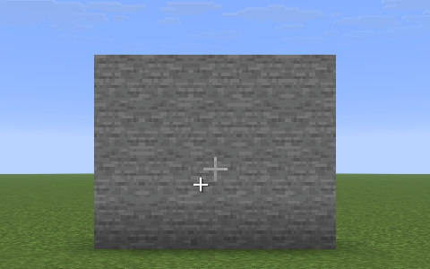
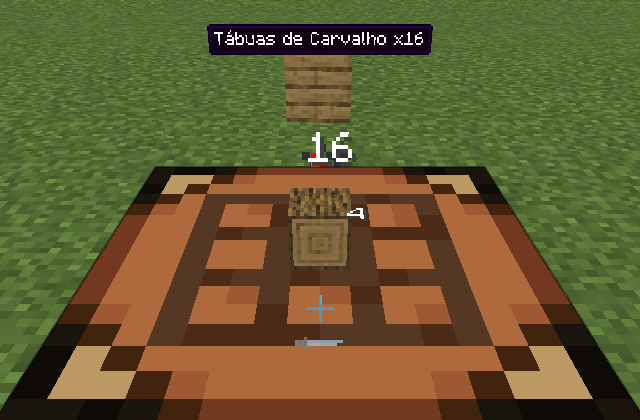
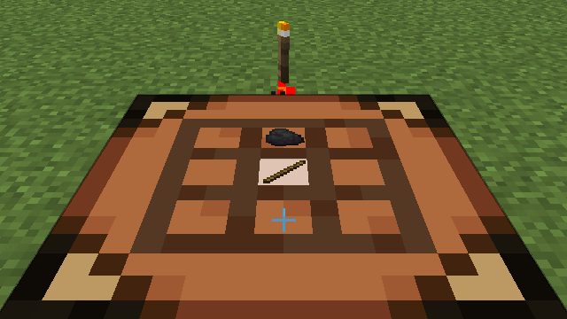
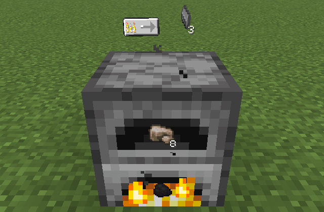
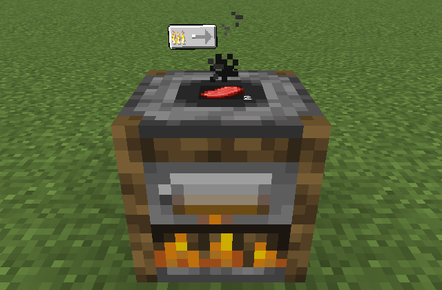
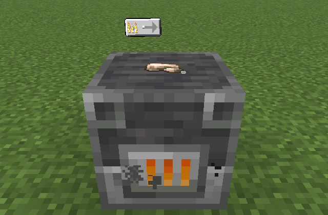
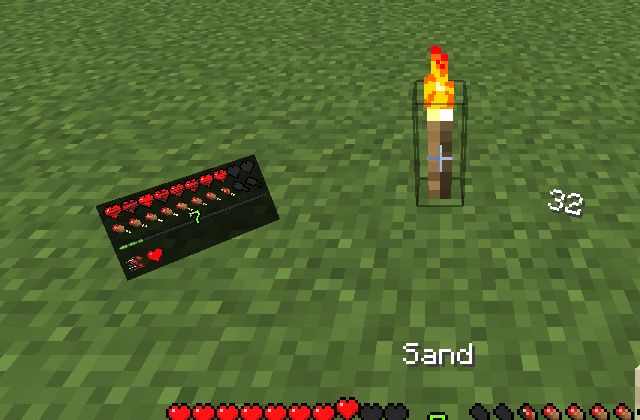
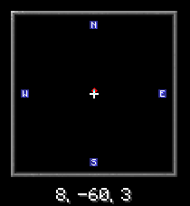
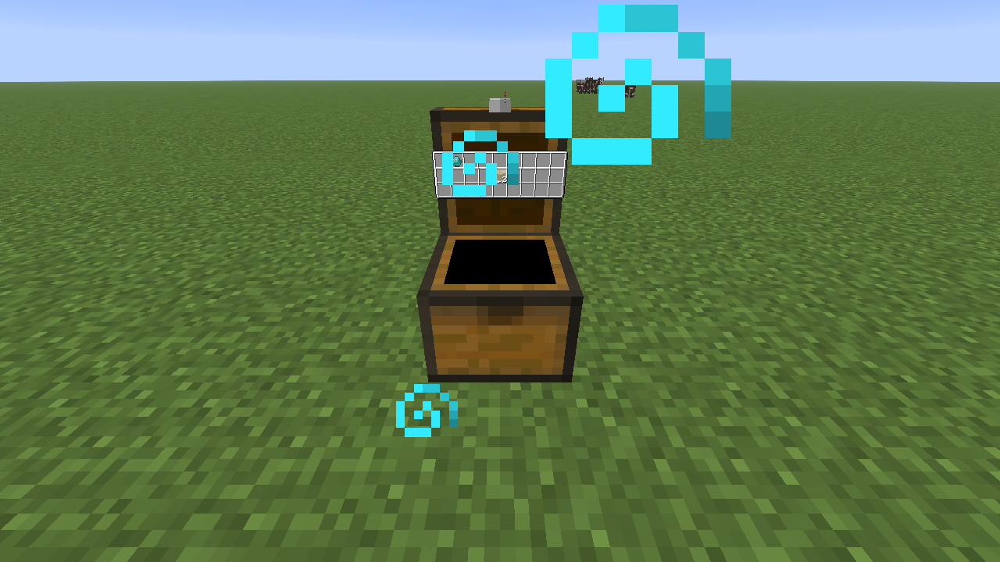
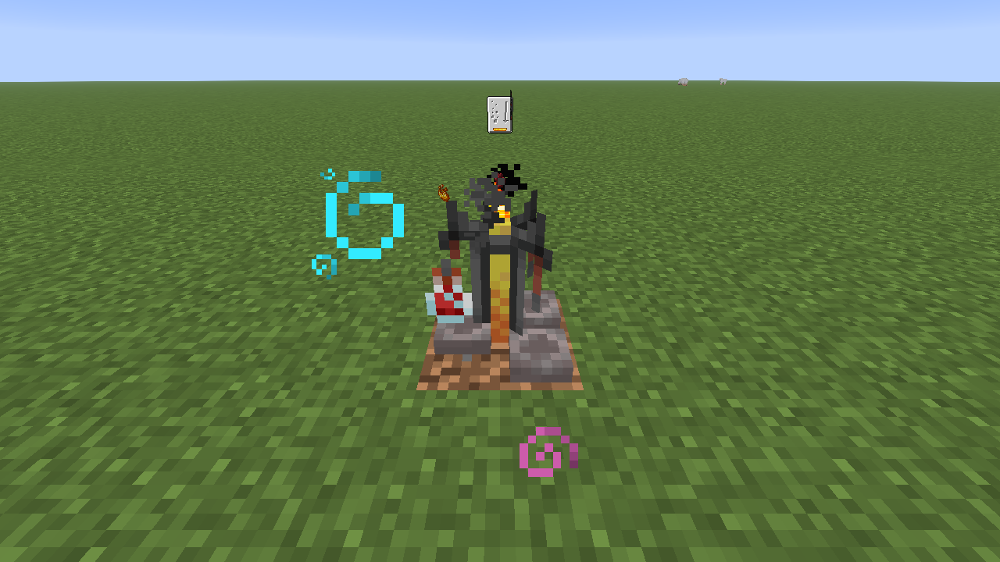

# HandsOn VR: design

Este documento descreve como o HandsOn VR deve se comportar. As issues do GitHub apontam para as seções daqui.

O objetivo é deixar o inventário do Minecraft com cara de jogo nativo de VR: o jogador mexe nos itens com as mãos, sem abrir telas que o deixam parado.

## Resumo

| Recurso | O que é | Exemplo |
|---|---|---|
| Coldres físicos | Ombro direito e os dois quadris guardam qualquer item. | Mão no quadril + grip: pega a picareta. Solta o grip: ela volta. |
| Mochila | Fica no ombro esquerdo e substitui a tela de inventário. | Pega a mochila com o grip, tira o arco com a outra mão, usa e solta. |
| Menu radial | X ou B abre a hotbar em círculo ao redor da mão. | Segura B, leva a mão até a espada, solta B: espada na mão. |
| Regra das mãos | O grip pega emprestado. O radial equipa. | Com a espada equipada, pega o arco com o grip. Ao soltar, a espada volta. |

## Controles (Quest 2)

| Botão | Ação |
|---|---|
| Grip (dedo do meio) | Pegar algo enquanto estiver apertado: item de um coldre, a mochila ou um item da mochila ou do radial. Em qualquer outro lugar, **segura o item da própria mão**. |
| Soltar o grip | Devolve o item ao lugar de onde veio. Se a mão estiver sobre um espaço, coloca a pilha inteira nele. Num coldre, guarda o item ali; no ombro esquerdo, guarda na mochila. |
| Gatilho (indicador), com o grip apertado sobre um espaço | Coloca **um** item no espaço. Na zona de descarte, solta **um** item no chão. |
| Gatilho segurado, passando a mão por vários espaços (com o grip apertado) | Ao soltar o gatilho, **divide a pilha igualmente** entre os espaços marcados, como arrastar na tela do jogo. Vale na mesa de trabalho e na mochila. |
| Gatilho apertado + grip num espaço com itens | Pega **a metade** (como o clique direito da tela do jogo). |
| Soltar o grip no meio de um arremesso | Joga **um** item arremessável (bola de neve, ovo, pérola, poção arremessável, carga de vento) na direção do movimento. |
| B (mão direita) | Enquanto estiver apertado, mostra o menu radial da mão direita. |
| X (mão esquerda) | Enquanto estiver apertado, mostra o menu radial da mão esquerda. |
| Analógico direito | Do Vivecraft: gira a câmera. O mod não usa (até a 0.2.4, trocava a hotbar). |

O B substitui o menu radial do Vivecraft e o X substitui a tela de inventário. Os dois podem voltar ao comportamento original nas Opções HandsOn VR. Abaixo do círculo fica o **descarte** (como o da mochila): soltar o grip ali com um item joga a pilha fora, o gatilho joga um, e soltar o botão sobre ele joga fora a pilha da mão.

Fora dos coldres e da mochila, o grip não troca mais o item da hotbar (o Vivecraft fazia isso): ele segura o item da mão, para levá-lo a um coldre ou à mochila. Isso também pode voltar nos ajustes ("grip troca a hotbar"); com a opção ligada, o grip só segura o item dentro das zonas do corpo.

## Inventário: por que nunca falta espaço

No Minecraft, a mão não guarda nada. Ela só aponta para um espaço:

- a mão direita aponta para o espaço selecionado da hotbar;
- a mão esquerda aponta para o espaço da mão secundária (*offhand*).

Pegar algo com o grip é uma **troca**. O item pego vai para o espaço da mão, e o que estava na mão vai para o lugar de onde ele saiu. Soltar o grip faz a troca de volta.

Como em nenhum momento um espaço fica vazio, isso funciona até com o inventário cheio de terra.

Tudo usa os mesmos pacotes de clique da tela de inventário do Minecraft: trocar com a hotbar (teclas 1 a 9 e F), pegar, colocar e jogar fora. Por isso o mod não precisa estar instalado no servidor.

### Itens que chegam vão para a mochila

No jogo original, um item coletado do chão vai para o primeiro espaço livre da **hotbar**, e o inventário principal só recebe depois que ela enche. Em VR, a hotbar é o que está à mão (o radial), então ela ia enchendo de blocos que o jogador não escolheu.

Com o HandsOn, o que chega vai primeiro para o **inventário principal** (a mochila). A hotbar só recebe quando ele está cheio.

- Vale para tudo o que o jogo põe "no primeiro espaço livre": coletar do chão, receber um item (`/give`, recompensas) e as sobras que voltam de uma grade de crafting.
- Um item igual a uma pilha que já existe continua se juntando a ela, onde ela estiver. As tochas coletadas vão para as tochas da hotbar.

Como é feito:

| Onde | Como |
|---|---|
| Mundo um jogador e LAN aberta pelo próprio jogador | O servidor roda no mesmo programa. Um mixin muda a escolha do espaço livre (`Inventory.getFreeSlot`) só para o jogador local, e nada passa pela hotbar. |
| Servidor de outra pessoa (o mod só no cliente) | O servidor põe o item na hotbar. No tick seguinte, um item **novo** que caiu num espaço vazio da hotbar é levado para um espaço vazio do inventário principal, com os cliques normais. "Novo" quer dizer que a quantidade dele no inventário aumentou. Um item que o próprio jogador levou para a hotbar não é mexido, porque a soma não muda. |

A opção "Coleta na mochila" nas Opções HandsOn VR volta ao comportamento do jogo.

### Mão vazia

A mão só fica vazia se houver para onde ir:

- **Mão direita:** precisa existir um espaço vazio na hotbar. O mod seleciona esse espaço.
- **Mão esquerda:** o item volta para o espaço de onde o radial o tirou. Se a mão continuar ocupada, o item vai para um espaço vazio do inventário.

Sem espaço livre, a opção "mão vazia" do radial mostra a barreira do jogo e o controle vibra em sinal de "negado".

## 1. Coldres físicos

Os coldres ficam no **ombro direito**, no **quadril direito** e no **quadril esquerdo**. O ombro esquerdo é da mochila.

- **Área de pegar:** cada coldre é um elipsoide no referencial do tronco, e não uma esfera pequena.
  - Ombro: a mão pode estar atrás, ao lado ou acima do ombro, do pescoço até um pouco acima da cabeça.
  - Quadril: a mão pode estar do lado da cintura, um pouco à frente ou atrás.
- **Saída com folga:** a área de saída é maior que a de entrada (histerese), para a vibração não ficar piscando na borda.
- **Tronco:** o tronco só gira quando a cabeça vira além de 35°. Olhar para o lado não leva os coldres junto.
- **Sacar:** mão no coldre + grip. O item vai para a mão. O que estava na mão fica guardado até o grip ser solto.
- **Guardar o item da mão:** feche a mão no item (grip) em qualquer lugar, leve-o até o coldre e solte o grip, como nos jogos de VR. Apertar e soltar o grip com a mão já dentro do coldre também guarda.
  - Se o item estava na hotbar ou na mão esquerda e há espaço livre no inventário principal, ele vai para lá e a mão fica vazia, como a espada na bainha. Sem espaço livre, o item fica onde está, e o coldre lembra dele assim mesmo.
  - Num coldre **ocupado**, o coldre passa a lembrar do item novo. O antigo continua no inventário.
  - Enquanto o grip estiver apertado, nada muda: soltar longe dos coldres deixa o item na mão.
- **Guardar um item pego de outro lugar:** pegue um item da mochila ou do radial com o grip e solte o grip dentro do coldre. O coldre passa a lembrar desse item.
- **Qualquer item:** o coldre lembra o item (id e nome) e o espaço do inventário onde ele está. O item não precisa estar na hotbar.
- **Guardar na mochila tira do coldre:** sacar o item de um coldre e guardá-lo na mochila (soltando por cima do ombro esquerdo, ou num espaço da mochila aberta) esvazia o coldre.
- **Resposta:** o controle vibra ao entrar num coldre onde o grip faz algo (inclusive com um item seguro, onde soltar o guarda), e o item desenhado no corpo cresce um pouco.

## 2. Mochila (ombro esquerdo)

**Abrir:** qualquer mão no ombro esquerdo + grip. A mochila aparece presa a essa mão, virada para o rosto. Ela some quando o grip é solto.

O item que essa mão segurava (por exemplo, uma tocha) **some** enquanto ela segura a mochila. Essa mão também não ataca nem usa itens nesse tempo.

### Layout

A ideia vem da mochila de *The Walking Dead: Saints & Sinners*, mas o visual é o do **inventário do Minecraft** (ver o [padrão visual](VISUAL.md)). Dentro da borda de lona da mochila há uma janela cinza com relevo, e todos os espaços são quadrados como no jogo (fundo cinza, linha escura em cima e à esquerda, clara embaixo e à direita).

```
┌──────────────────────────────────────┐
│ Fabricação                           │
│ [c][c]            [cap.][peito]      │  crafting 2x2 + resultado
│ [c][c]  ──▶ [r]   [pern][botas]      │  armadura (ícones do jogo)
│                                      │
│        [   ][   ][   ]               │
│        [   ][   ][   ]               │  página 3x3 (espaços maiores)
│        [   ][   ][   ]               │
│                                      │
│  ◀   Página 1/3   ▶         [⤓]      │  páginas + descarte
│      Espaços 5/27                    │
└──────────────────────────────────────┘
```

- **3 páginas de 3x3:** 27 espaços, exatamente o inventário principal do Minecraft. A hotbar fica no radial. Os espaços da página são maiores que os do crafting (cerca de 9 cm), para a mão acertar com folga. Lado a lado, como no jogo, o toque vale no quadrado inteiro.
- **Crafting 2x2:** o mesmo do inventário do jogador, com o título "Fabricação" e a seta cinza do jogo. Ao fechar a mochila, o que sobrou na grade volta para o inventário, como na tela original.
- **Armadura:** capacete, peitoral, calças e botas. O espaço vazio mostra o ícone do próprio jogo.
- **Zona de descarte:** um espaço no canto inferior direito, com uma seta para o chão.
- **Setas de página:** as do livro de receitas do jogo. Elas acendem com a mão em cima.
- **Mão em cima de um espaço:** o espaço clareia, como o cursor no inventário, e o controle vibra.
- **Ícones do jogo:** armadura e setas são lidas das texturas carregadas. Um resource pack que as mude também muda a mochila.
- **Desenho opaco:** o painel é desenhado opaco, inclusive os ícones (pixel a pixel). O translúcido do Minecraft 26 (OIT) mistura camadas a milímetros umas das outras.

### Interação com a outra mão

| Gesto | Resultado |
|---|---|
| Grip sobre um espaço com item (inventário, crafting ou armadura vestida) | Pega o item: ele fica na mão e pode ser usado na hora. Uma armadura vestida sai do corpo enquanto a mão a segura. |
| Grip sobre um espaço vazio, o fundo do painel ou o descarte, com um item na mão | Segura o item da própria mão (ele continua na mão). |
| Soltar o item da mão sobre um espaço | Guarda o item ali: num espaço vazio, ocupa; sobre uma pilha igual, junta; sobre outro item, troca (o outro vai para a mão). |
| Soltar o grip sobre outro espaço | Coloca a pilha toda nesse espaço. Pilhas iguais se juntam; diferentes trocam de lugar. |
| Soltar o grip longe da mochila | O item volta para o espaço de onde veio. |
| Gatilho com o grip apertado sobre um espaço | Coloca um item por vez (por exemplo, uma tábua em cada espaço do crafting). O item entra ao soltar o gatilho. |
| Gatilho segurado passando por vários espaços (inventário ou crafting) | Ao soltar o gatilho, a pilha se divide igualmente entre os espaços marcados (eles clareiam e o controle vibra em cada um). O que sobrar fica na mão. |
| Gatilho apertado + grip num espaço com itens | Vem a metade para a mão (arredondada para cima); a outra metade fica. |
| Soltar o grip na zona de descarte | Solta a pilha inteira no chão (64 de areia, ou a espada). |
| Gatilho com o grip apertado na zona de descarte | Solta um item por vez. |
| Grip ou gatilho numa seta | Troca de página. |
| Segurar um item sobre uma seta por meio segundo | Troca de página, para levar o item de uma página a outra. |
| Grip no resultado do crafting | Fabrica **uma vez** e o resultado vai para a mão que pegou (4 toras: 4 tábuas, e sobram 3 toras). A mão direita usa o espaço dela, se estiver vazio ou já tiver o mesmo item, ou um espaço vazio da hotbar (o item que ela tinha continua na hotbar); a esquerda recebe o resultado no lugar do que tinha. Com o grip ainda apertado, soltar num coldre, na mochila ou no radial guarda o resultado; em outro lugar, ele fica na mão. |
| Gatilho com o grip no resultado | Fabrica **tudo** o que a grade der (como o Shift+clique), juntando na mesma mão; o que não couber vai para o inventário. Vale apertar o grip primeiro (uma vez, depois o resto) ou o gatilho primeiro (tudo de uma vez). Gatilho sem o grip não fabrica. |
| Soltar uma peça de armadura no espaço dela | Veste a peça. Se já havia uma, a antiga vai para o lugar de onde a nova saiu. |
| Soltar uma armadura pega do corpo longe de tudo | Ela volta a ser vestida. |
| Soltar uma armadura pega do corpo sobre um item que não se veste (terra) | Recusado com vibração: a terra não pode ir para o pé. |

A mochila pode ser solta enquanto a outra mão segura um item. O item continua na mão até o grip dessa mão ser solto. Um item pego do crafting volta para lá quando a mochila fecha, e a sobra do crafting vai para o inventário.

**Armadura com a mão cheia:** pegar a armadura vestida é uma troca com o espaço da mão. Se o item da mão não pode ir para o lugar da armadura (uma espada no espaço da bota), a mão direita passa para um espaço vazio da hotbar enquanto segura a peça e volta ao soltar. Sem espaço vazio na hotbar, ou com a mão esquerda ocupada, o controle vibra e nada muda. Armadura com Maldição do Vínculo não sai.

## 3. Menu radial da hotbar (X ou B)

- **Abrir:** segure B para a mão direita ou X para a mão esquerda. O menu abre em volta da mão, virado para o rosto, com a hotbar (9 espaços) em círculo e a **mão vazia** no centro.
- **Acompanha o jogador:** o menu fica preso à área de jogo do Vivecraft. Andar, cair ou virar com o analógico o leva junto. Mexer a cabeça ou se inclinar para alcançar um espaço não o move.
- **Escolher:** passe a mão sobre uma opção. Ela fica destacada e o controle vibra. Ao soltar o botão, o item fica equipado na mão.
- **Mão direita:** seleciona o espaço da hotbar.
- **Mão esquerda:** troca o item da hotbar com a mão secundária. Ao escolher outro item ou a mão vazia, o anterior volta para o espaço dele na hotbar.

### Visual: a hotbar do jogo


O radial segue o [padrão visual](VISUAL.md) com a cara da **hotbar**:

- Cada espaço é uma casa da hotbar do jogo: moldura de pedra e fundo escuro translúcido.
- A **moldura de seleção** da hotbar fica no espaço sob a mão. Sem a mão em cima, ela fica no item que está na mão (como quando você gira a roda do mouse).
- O **nome do item** sob a mão aparece na caixa de dica do jogo, com a cor da raridade.
- O item da **mão esquerda** leva o ícone do escudo no canto, o mesmo do espaço da mão secundária no inventário.
- No centro, a **mão vazia** é uma casa vazia. Sem espaço livre para esvaziar a mão, ela mostra a barreira do jogo.
- A quantidade usa a fonte e a sombra do jogo, como na hotbar.

### Levar um item da mochila para a hotbar

1. Pegue o item na mochila com o grip.
2. Com o grip ainda apertado, abra o radial (X ou B).
3. Passe o item sobre um espaço do radial e solte o grip.

O item vai para aquele espaço da hotbar, e o que estava lá vai para o lugar de onde o item veio.

### Levar um item da hotbar para a mochila

São três jeitos:

- **Por cima do ombro** (como no *Saints & Sinners*): feche a mão no item (grip), leve a mão ao ombro esquerdo e solte. O item vai para a mochila: primeiro junta com pilhas iguais, depois ocupa o primeiro espaço livre. Armaduras não são vestidas. Com a mochila cheia, o controle vibra e o item fica na mão.
- **Com a mochila aberta:** grip num espaço vazio (ou no fundo do painel) com o item na mão, e solte o grip sobre o espaço onde ele deve ficar.
- **Pelo radial:** com o radial aberto, aperte o grip sobre um item do radial para pegá-lo e solte o grip sobre um espaço da mochila.

Apertar o grip no ombro esquerdo **sem** um item seguro abre a mochila. Com um item seguro, soltar ali o guarda.

## 4. Regra das mãos

| Como chegou à mão | O que acontece ao soltar o grip |
|---|---|
| Pelo radial ou pela hotbar | Nada: o item continua na mão (sem grip). |
| Pegado com o grip (coldre, mochila ou radial) | O item volta para o lugar dele e a mão volta a segurar o que tinha antes. |
| O item da própria mão, seguro com o grip | Num coldre, no ombro da mochila ou num espaço, é guardado ali. Em qualquer outro lugar, continua na mão. Se o item da mão mudar com o grip apertado (a hotbar mudou, o item acabou), o grip solta o item antigo. |

Exemplo com as duas mãos:

1. A mão esquerda está com uma tocha e a direita com uma espada, as duas equipadas pelo radial.
2. A esquerda pega a mochila: a tocha some.
3. A direita pega o arco da mochila: a espada some e o arco aparece na mão direita (seção 5).
4. A esquerda solta a mochila: a mochila some e a flecha aparece nela, pronta para puxar a corda. A tocha continua na mão esquerda, escondida enquanto o arco estiver na direita.
5. A direita solta o grip: o arco volta para a mochila e a espada volta para a mão.

## 5. Arco

O arco do Vivecraft ("Roomscale Bow") funciona assim:

- o arco é desenhado num controle e a flecha no outro;
- para atirar, encoste a mão da flecha na corda do arco (o controle vibra quando a flecha encaixa), segure o gatilho dessa mão, puxe para trás e solte o gatilho;
- o arco precisa estar no espaço da mão principal para usar as flechas do inventário.

Sozinho, o Vivecraft não segue a mão que pegou o arco: ele sempre desenha o arco no controle esquerdo e a flecha no direito. Só a opção "Reverse Bow" dele inverte isso. Por isso, pegar o arco com a mão direita trazia as flechas para ela.

Com o HandsOn, **o arco fica na mão que o pegou, e a flecha aparece na outra**:

| Quem pegou | Onde o arco fica no inventário | O que o mod faz no Vivecraft |
|---|---|---|
| Mão direita (grip na mochila ou num coldre, B no radial) | Espaço da mão principal | Liga o "Reverse Bow": arco na direita, flecha na esquerda |
| Mão esquerda (grip na mochila ou num coldre, X no radial) | Espaço da mão principal, para o Vivecraft usar as flechas do inventário. O item da mão direita espera no lugar do arco, como em toda pegada. | Desliga o "Reverse Bow": arco na esquerda, flecha na direita |

- Sem o arco na mão (ou com uma tela aberta, como os ajustes do Vivecraft), a escolha do jogador no "Reverse Bow" volta.
- Segurar o próprio item com o grip não troca o arco de mão (apertar o grip da mão da flecha não o faz pular para ela).
- O gatilho da mão da flecha é sempre do Vivecraft. Com o arco na direita, o gatilho esquerdo não usa o item da mão esquerda.
- O arco pego com o grip continua emprestado: ele volta para onde estava quando o grip solta. Para atirar, segure o grip da mão do arco, ou ponha o arco na hotbar e escolha pelo radial.
- A mão que segura a mochila esconde o que estiver nela, inclusive a flecha: feche a mochila antes de atirar.
- Num servidor com um Vivecraft antigo, o "Reverse Bow" não funciona e o arco fica sempre na esquerda.

### Mira do arco



Nas Opções HandsOn VR, "Mira do arco" (ligada por padrão desde a 0.8.4). Ligada, com a corda puxada, a mira do jogo (`hud/crosshair`) aparece no ponto em que a flecha vai acertar. A conta segue o jogo com o arco do Vivecraft:

- a flecha sai da mão que puxa a corda, na direção dela para a mão do arco;
- a velocidade é a do arco do jogo (a força pelo tempo puxando, até 1 em um segundo, vezes 3) vezes o quanto a corda está puxada;
- a cada tick a flecha anda, perde 1% da velocidade e cai 0,05; o ponto é o primeiro bloco ou criatura no caminho.

Não conta a pequena imprecisão aleatória do arco: é uma ajuda, não uma garantia. A mira fica do mesmo tamanho na vista a qualquer distância, virada para o rosto, branca com a sombra do jogo.

## 6. Mesa de trabalho (imersiva)

A nossa versão da mesa do ImmersiveMC: fabricar em cima da própria mesa, sem a tela do jogo.



1. Chegue na frente de uma mesa de trabalho e abra a mochila numa mão.
2. Com a outra mão, pegue um item (grip) e leve-o até uma casa da grade 3x3 desenhada no topo da mesa. A casa sob a mão clareia e o controle vibra.
3. Solte o grip: a **pilha inteira** fica deitada na casa, como num espaço do crafting da mochila. Uma casa com outro item troca de lugar com ele. Com o grip apertado, o **gatilho** põe **um** item por vez e a mão continua segurando o resto, então dá para "distribuir" um item por várias casas.
4. Quando a receita fecha, o item que será fabricado aparece **flutuando** acima da grade, girando devagar. Ao lado dele aparece o **total** que o grip + gatilho vai fabricar (4 toras: 16 tábuas), como a quantidade de um espaço do inventário. Com a mão perto, ele cresce um pouco e mostra o nome e o total na caixa de dica do jogo. Cada casa com mais de um item mostra a quantidade no canto mais perto do jogador, deitada na mesa.
5. **Grip no item flutuante:** fabrica **uma vez** e o resultado vai para a **mão que o pegou**, como no crafting da mochila: um pack de toras dá 4 tábuas na mão e sobram 63 toras na mesa. Com o grip ainda apertado, soltar num coldre, na mochila, no radial ou numa casa da mesa guarda o resultado ali; em outro lugar, ele fica na mão.
6. **Gatilho com o grip no item flutuante:** fabrica **tudo** o que a grade der (como o Shift+clique da tela do jogo: 4 toras dão 16 tábuas), juntando na mesma mão. Dá para apertar o grip e depois o gatilho (uma vez, depois o resto) ou o gatilho e depois o grip (tudo de uma vez). Gatilho sem o grip não fabrica.
7. **Grip numa casa ocupada:** o que está nela volta para a mão. Com o **gatilho já apertado**, vem só **a metade** (arredondada para cima, como o clique direito da tela do jogo).
8. **Distribuir:** segurando a pilha, aperte o gatilho numa casa e, **sem soltar o gatilho**, passe a mão pelas outras. Cada casa marcada clareia e o controle vibra. Ao soltar o gatilho, a pilha se divide igualmente entre elas, como arrastar na tela do jogo: 9 canas pela linha de cima viram 3 em cada casa. O que sobrar fica na mão. Soltar o gatilho na mesma casa em que apertou põe um item só.

| Detalhe | Como é |
|---|---|
| Orientação | A linha de cima da receita é a mais longe do jogador, como na tela do jogo. O lado é escolhido (entre os 4) quando a mesa abre e fica fixo até ela fechar. |
| Casas | As da própria textura da mesa (`crafting_table_top`): linhas nos pixels 3, 6, 9 e 12, casas de 3 pixels (18,75 cm) centradas no topo. A mão toca de 5 cm abaixo até 15 cm acima do topo. |
| Quando fecha | Ao se afastar mais de 4 m, ao abrir uma tela de inventário, ou depois de 5 s com a grade vazia e as mãos longe. Como no jogo, os itens da grade voltam para o inventário (para a mochila primeiro). |
| A tela normal | Usar a mesa do jeito de sempre (o "usar" apontando para ela) continua abrindo a tela do jogo. |

### Por baixo: a mesa do jogo, sem a tela

O mod não inventa receitas. Na primeira vez que a mão leva um item à mesa, ele "usa" a mesa como o jogador faria: o servidor abre o menu da mesa e o mod fica com esse menu **sem abrir a tela** (um mixin em `MenuScreens.create`). A grade e o resultado são os do servidor, que confere a receita. Tudo usa os cliques normais do menu, então funciona em qualquer servidor, sem o mod nele.

Enquanto o menu da mesa está aberto, o resto do mod continua funcionando pelos cliques desse menu (`InvOps`). O menu da mesa tem o inventário principal e a hotbar (um espaço adiante), e a troca com a mão secundária também funciona. **A armadura e o crafting 2x2 não existem nesse menu**: com a mesa aberta, mexer neles na mochila vibra "negado" e espera a mesa fechar. Pelo mesmo motivo, a mesa não abre com um item pego da armadura ou do crafting 2x2, nem com o crafting 2x2 ocupado.

Com a mão sobre a mesa, o golpe com o braço do Vivecraft fica desligado, para não quebrar a mesa ao pôr os itens.



## 7. Fornalhas (imersivas)

A fornalha comum, o alto-forno e o defumador também são usados com as mãos, sem a tela do jogo, do mesmo jeito que a mesa de trabalho.



1. Chegue perto de uma fornalha e olhe para ela: ela "abre" por baixo (sem a tela) e mostra o que tem dentro.
2. Pegue um item (grip) e leve-o ao lugar dele. O lugar sob a mão clareia e o controle vibra. Solte o grip para pôr a **pilha inteira**. Com o grip apertado, o **gatilho** põe **um** item por vez.
3. Acima do bloco, virada para você, aparece a **barra de progresso** da tela do jogo, recortada da própria textura da tela:
   - a **chama** mostra quanto ainda queima o combustível;
   - a **seta** mostra quanto o item atual já cozinhou.
4. O que fica pronto **flutua à direita da seta**, com a quantidade. **Grip** nele leva tudo o que está pronto para a mão que pegou, com a experiência do jogo (como o clique na tela). Na mão direita, o resultado se junta ao que ela já tem do mesmo item; senão, ocupa um espaço vazio da hotbar, como no crafting.
5. **Grip na entrada ou no combustível com item:** o item volta para a mão.

| Bloco | O que vai cozinhar | Combustível |
|---|---|---|
| Fornalha | Em pé, na abertura de cima da frente | Em pé, na abertura de baixo da frente (onde aparece o fogo) |
| Alto-forno | Deitado no topo. O alto-forno é carregado por cima, como um de verdade. | Na grade de fogo da frente |
| Defumador | Deitado em cima da chaminé (o quadrado escuro do topo), como numa grelha | No fogo da frente |

A frente do alto-forno e a do defumador não têm duas aberturas como a da fornalha. Por isso o que vai cozinhar fica no topo deles, que também fica mais perto da mão de quem está em pé.





| Detalhe | Como é |
|---|---|
| O que cada lugar aceita | A entrada aceita só o que cozinha naquele bloco (minério no alto-forno, comida no defumador). O combustível aceita só o que queima. O resto vibra "negado". |
| Quando abre | Ao olhar para uma fornalha a até 2,4 m (até 45° do centro da vista), ou ao levar um item até ela. Com várias perto, vale a mais no centro da vista. |
| De longe | Todas as fornalhas a até 10 blocos mostram o que têm (os itens, a barra de progresso e o resultado). No singleplayer, ao vivo: o mod lê o servidor do próprio jogo a cada quarto de segundo. Em servidor remoto, a aberta aparece ao vivo e as outras com o que tinham na última vez que foram vistas abertas (o servidor só manda o conteúdo de uma fornalha aberta). |
| Quando fecha | Olhando para outro lado por 3 s, olhando para outra fornalha, ao se afastar mais de 4 m ou ao abrir uma tela. Os itens ficam na fornalha, como no jogo. |
| Mochila junto | A mochila funciona com a fornalha aberta. Mexer na armadura ou no crafting 2x2 fecha a fornalha na hora (ela não perde nada); depois, ela espera 5 s antes de abrir sozinha de novo. |
| Mesa de trabalho perto | Só um bloco fica aberto por vez: a mesa, ao receber um item, fecha a fornalha. |
| A tela normal | Usar a fornalha do jeito de sempre (o "usar" apontando para ela) continua abrindo a tela do jogo. |

Por baixo, é a fornalha do jogo: o mod a "usa" como o jogador faria e fica com o menu sem a tela, como na mesa. O conteúdo, o progresso e o resultado são os do servidor, e tudo usa os cliques normais do menu. Funciona em qualquer servidor.

## 8. Arremesso com a mão

Bola de neve, ovo, pérola do Ender, poção arremessável e persistente, frasco de experiência e carga de vento são jogados com o movimento do braço.

1. Segure o item com o grip: o da própria mão, ou pegue de um coldre, da mochila ou do radial.
2. Faça o movimento de arremesso e **solte o grip** no meio dele. Sai **um** item, na direção em que a mão estava indo, e o controle vibra.
3. O resto da pilha segue a regra de sempre: volta para o coldre ou a mochila de onde veio, ou fica na mão.
4. Um movimento devagar (menos de 2 m/s) não arremessa: soltar faz o de sempre.
5. O gatilho com o item na mão continua arremessando do jeito do Vivecraft, para onde o controle aponta.

| Detalhe | Como é |
|---|---|
| Direção | A velocidade da mão nos últimos 0,1 s antes de soltar, medida no quarto. Andar ou girar com o analógico não entortam o arremesso. |
| Como sai | Pelo "usar item" do jogo, com a mira trocada pela direção do gesto (a mesma função do Vivecraft que o golpe de espada dele usa). Funciona com e sem o Vivecraft no servidor. |
| Poções e frasco de experiência | O jogo os joga 20° acima da mira. O mod desconta isso, e eles saem na direção da mão. |
| Velocidade em servidores | Sempre a do jogo: 1,5 bloco por tick para bola de neve, ovo, pérola e carga de vento; 0,5 para as poções; 0,7 para o frasco. O gesto escolhe só a direção e o momento, como mirar com o mouse. |
| Força real (singleplayer) | No singleplayer o servidor é o do próprio jogo, então a força do gesto muda a velocidade. A mão a 6 m/s dá a força do jogo; mais devagar, o item cai perto (até 35% da força); mais rápido, vai um pouco além (até 130%). Opção "Força real (singleplayer)", ligada por padrão. Em servidor remoto nunca muda nada. |
| Recarga | A pérola do Ender e a carga de vento esperam a recarga do jogo. Durante ela, soltar não arremessa. |
| Desligar | "Arremesso com a mão" nos ajustes. |
| Na mão | O Vivecraft desenha os arremessáveis uns 8 cm à frente do controle, como se flutuassem. O mod os desenha na palma, como a comida, que é como se segura para arremessar. |
| Ainda não | O tridente, que carrega antes de lançar. |

### Servidores: isso é cheat?

O mod só manda ao servidor os mesmos pacotes de um jogador de computador: os cliques da tela de inventário, trocar o item da mão, "usar item" com uma mira. Nada sai mais rápido, mais longe ou de um jeito impossível no teclado e mouse.

| Recurso | Equivale a |
|---|---|
| Coldres e radial | As teclas 1-9 e F |
| Mochila | Os cliques da tela de inventário |
| Fabricar tudo | O Shift+clique |
| Arremesso com a mão | Mirar com o mouse e clicar |

O que pede cuidado:

- **Informação que o jogo não dá:** a mira do arco (ligada por padrão; dá para desligar). Servidores de PvP costumam proibir esse tipo de ajuda.
- **Ação sem o jogador pedir:** a coleta para a mochila em servidor remoto (move o item da hotbar sozinha, como os mods de organizar inventário). Ela tem opção para desligar.
- **Anticheat de servidor grande:** cliques no inventário andando, vários cliques no mesmo tick e a mira mudando de repente no arremesso podem gerar alerta, mesmo sem ser cheat.

## 9. Pulso e quantidade na mão



- **Pulso esquerdo:** grudado na lateral interna do antebraço esquerdo, como o HUD "no pulso" do Vivecraft: anda e gira com o controle, deitado ao longo do braço (a leitura vai do cotovelo para a mão). Mostra a vida (corações), a armadura, a fome, a barra de XP com o nível e os ícones dos efeitos ativos, com os ícones do HUD do jogo, pequenos, num fundo escuro como o do chat. Para ler, vire o lado interno do braço para o rosto. Continua aparecendo com a mochila na mão (só o item some). Fica afastado do braço o bastante para não ser coberto pela segunda camada (mangas) das skins.
- **Quantidade na mão:** grudada na lateral do dedão de cada mão (presa ao controle, como o relógio, e fora do modelo da mão) aparece a quantidade da pilha que ela segura, como num espaço do inventário. O que é sozinho (espada, arco) não mostra nada.
- É só desenho do cliente: os outros jogadores não veem.
- Opções "Relógio no pulso" e "Quantidade na mão".
- **HUD do Vivecraft (pulso esquerdo, de fora):** em VR fica sempre à vista e no pulso, só com o chat, a lista de jogadores, os títulos, a barra de ação, a barra do chefe, o placar e o HUD de outros mods (o minimapa do Xaero, se instalado). A hotbar, a vida, a fome, a XP, os efeitos e a mira saem dele. Escondido pelo F1, o HandsOn mostra ao ligar o VR e devolve ao desligar (só em memória).
- **Minimapa no pulso direito:** com o Xaero's Minimap instalado, o minimapa sai do HUD do Vivecraft (pulso esquerdo) e fica grudado na parte de dentro do pulso direito. Levante a mão direita com a palma virada para o rosto: o mapa fica de pé, com o "cima" dele apontando para os dedos. É o mesmo desenho do Xaero (as mesmas cores, o mesmo tamanho em pixels, as coordenadas embaixo), só que recortado do HUD: o HandsOn anota onde o Xaero desenhou neste quadro, mostra só aquele pedaço no pulso direito e tira esse pedaço do painel do pulso esquerdo (o chat e o resto continuam lá). Opção "Minimapa no pulso direito".

  


### FTB Ultimine (opcional)

> **Ainda não funciona no 26.3:** o FTB Ultimine mais novo é para o 26.1.2 e fecha o jogo do 26.3 ao abrir (testado numa cópia dos mods). Os botões abaixo estão prontos para quando sair a versão do 26.3.

Com o FTB Ultimine instalado, aparecem três botões logo abaixo do relógio do pulso esquerdo, com as texturas do jogo:

| Botão | O que faz |
|---|---|
| Picareta (meio) | Liga e desliga o Ultimine. Fica clara enquanto ligado. É como segurar a tecla do Ultimine no computador. |
| Seta da esquerda / da direita | Forma anterior / próxima (sem forma, túnel, 3x3...). Liga o Ultimine se estava desligado. |

- Aperte encostando a ponta da mão direita no botão (um instante parado; para apertar de novo, tire a mão e volte). O controle vibra.
- Com o Ultimine ligado, quebre um bloco como sempre: o grupo inteiro quebra, e o próprio Ultimine contorna o grupo e mostra a lista de formas no HUD.
- Por baixo é a tecla do Ultimine segurada pelo HandsOn e o pedido de troca de forma do próprio Ultimine: o servidor (que precisa ter o Ultimine) decide tudo, como no computador. Sem o Ultimine, os botões não aparecem.

## 10. Fogueira e armadura no corpo

- **Fogueira:** com comida crua na mão, chegue perto da fogueira: um espaço do inventário do jogo aparece flutuando sobre cada canto livre dela. O jogo enche sempre o primeiro canto livre na ordem dele, então a comida pode aparecer em outro canto que não o tocado. **Encoste a mão na fogueira** (sem apertar nada) e um item vai para ela, pelo "usar" do jogo; o espaço clareia quando a mão está no lugar. Para pôr outro, tire a mão e encoste de novo. Também dá para segurar com o grip e soltar em cima, e o gatilho com o grip apertado põe um. Como no jogo, a comida não sai antes de cozinhar; pronta, ela cai no chão.
- **Vestir armadura:** solte a peça na parte do corpo dela: o capacete na cabeça, o peitoral (ou o élitro) no peito, as calças na cintura e as botas abaixo dos joelhos, sempre na frente do corpo (os coldres ficam dos lados e atrás). A peça que estava vestida vai para o lugar de onde a nova saiu.

## 11. Baú, barril e caixa de shulker



**Abrir com o movimento:** segure a borda da frente da tampa com o grip e **levante a mão** (12 cm bastam), como quem abre um baú de verdade. No barril e na caixa de shulker, puxe a face da tampa para fora. A tampa abre como no jogo, para todo mundo ver.

**Os itens ficam dentro do baú, sem página nem rolagem:**

| Bloco | Onde | Espaços |
|---|---|---|
| Baú simples (e com armadilha, e do Ender) | Deitados no fundo escuro da caixa aberta, com a fileira de cima do lado de lá |  9x3, espaços de 9,6 cm |
| Baú duplo | No fundo das duas metades juntas, duas vezes mais largo | 9x6, espaços de 14 cm |
| Barril e caixa de shulker | Deitados na face da tampa (no topo, virados para quem olha) | 9x3, espaços de 9,6 cm |

Os gestos são os da mochila:
- grip num espaço traz o item para a mão;
- com o gatilho já apertado, vem a metade;
- soltar o grip num espaço põe a pilha;
- o gatilho, com o grip apertado, põe um.

**Fechar:** grip no baú aberto e **empurre a mão para baixo** (no barril, para dentro). Se afastar mais de 4,5 m ou abrir uma tela também fecha.

Por baixo é o menu do jogo, aberto como o jogador faria: o jogo anima a tampa para todo mundo, e funciona em qualquer servidor. Como fechar não perde nada, o baú cede o menu quando a mochila precisa da armadura ou do crafting 2x2.

**O grip com a mão dentro do bloco:** ali o Vivecraft liga a ação "VR Interact" (o grip faz o "usar" do bloco, o que abria a janela antiga) e ela recebe o botão no lugar da ação que o HandsOn escuta. Por isso o HandsOn registra no Vivecraft um módulo de interação (`StationInteractModule`, prioridade 1400, antes do de blocos, 1500) que, com a mão num baú, barril, baú do Ender, caixa de shulker, suporte de poções, fornalha ou mesa de trabalho, é o próprio grip do HandsOn: apertar, segurar e soltar. O A (usar) olhando para o baú, em VR, também abre o baú imersivo.

**Com outros blocos ao mesmo tempo:** o servidor só deixa um menu aberto. Levando a mão à fornalha, ao suporte de poções ou à mesa, o baú cede o menu e fica suspenso (à vista, com o que tinha); a mão de volta aos espaços dele o reabre. **Dica do item:** a mão sobre um item mostra a caixa de dica do jogo (nome, encantamentos, descrição), na mochila e no baú. **Organizar (A-Z):** botão abaixo da grade do baú e à direita da primeira fileira da mochila; junta as pilhas iguais e ordena, com cliques normais (não depende do Inventory Profiles Next).

## 12. Suporte de poções



- Abre sozinho ao olhar para ele de perto (ou ao levar um item até ele), como as fornalhas.
- **Lugares**, os do próprio modelo do bloco:
  - as três garrafas nos braços (leste, noroeste e sudoeste da haste);
  - o ingrediente no topo da haste;
  - o pó de blaze ao lado do ingrediente, à esquerda de quem olha (como na tela do jogo), flutuando e longe dos outros; o espaço mostra o item da mão.
- O jogo já desenha as garrafas; o mod desenha o ingrediente girando no topo, o pó de blaze e o nome do que está sob a mão.
- Acima, a plaquinha com as **bolhas**, a **seta** do preparo e a **barra de combustível** da tela do jogo.
- **Encostar:** com o item na mão (garrafa, ingrediente ou pó de blaze), chegue perto e um espaço do inventário do jogo marca cada lugar vazio que aceita ele. **Encoste a mão ali** (sem apertar nada) e um item vai para o lugar; o espaço clareia quando a mão está nele.
- Com o grip: soltar num lugar põe a pilha, o gatilho põe um, grip num lugar com item o traz para a mão. Cada lugar só aceita o que a tela aceitaria.

## 13. Multiplayer: o que os outros veem

| Quem olha | O que vê de um jogador em VR com o HandsOn |
|---|---|
| Jogador sem o HandsOn | O jogo normal: o item na mão e a armadura. Com o Vivecraft, também os braços e a cabeça do VR. |
| Jogador com o HandsOn (em VR ou não) | Também os itens guardados nos coldres (ombros e quadris) e uma bolsa (o bundle do jogo) na mão de quem está com a mochila aberta. |

- Isso só existe onde o servidor roda o HandsOn: o mundo aberto pelo próprio jogo (singleplayer aberto para LAN, ou o Essential, que hospeda no jogo de quem convida). Num servidor sem o mod, nada é mandado.
- Os visuais de blocos (mesa, fornalhas, baú, suporte de poções) só aparecem para quem está em VR. Quem joga sem VR vê o jogo exatamente como sempre, mais os coldres e a mochila dos amigos em VR.
- O que vai pela rede é só o que está nos coldres e se a mochila está aberta, a cada meio segundo e só quando muda.

## Testes sem VR

O roteiro automático (`./gradlew prodClient`) cria um mundo plano e liga um "VR simulado". O teste posiciona as mãos e aperta grip, gatilho, X e B por código.

Ele confere:

- as zonas dos coldres, inclusive pontos da borda;
- sacar e guardar;
- abrir a mochila, pegar, mover, juntar pilhas, colocar um item, descartar tudo, descartar um, crafting, armadura e páginas;
- pegar a armadura vestida e o item do crafting com o grip: vem para a mão, volta ao soltar longe, vai para um espaço da mochila, recusa trocar com um item que não se veste;
- o radial: equipar nas duas mãos, mão vazia, mão vazia com o inventário cheio, levar itens da mochila para a hotbar e andar com ele aberto (ele vai junto e a escolha continua funcionando);
- o caso do inventário 100% cheio;
- guardar o item da mão: num espaço da mochila, juntando pilhas, no descarte, por cima do ombro (inclusive com a mochila cheia), num coldre vazio e num ocupado, com a mão esquerda, e soltar longe de tudo.
- a coleta: um item recebido e um coletado do chão vão para o inventário principal com a hotbar livre, juntam com a pilha igual da hotbar, vão para a hotbar com o inventário cheio, seguem o jogo com a opção desligada e, num servidor remoto (simulado), são levados da hotbar para o inventário.
- o arco: pego pela mão esquerda, vai para o espaço da mão principal e o "Reverse Bow" do Vivecraft fica desligado; pego pela direita (ou pelo B), fica ligado; pelo X, desligado; sem o arco na mão, volta ao que era.
- a mira do arco: nasce ligada, a força do arco pelo tempo, o tiro forte acertando a parede a 10 blocos e o fraco caindo no chão antes dela, a mira aparecendo na parede com a opção ligada (print `12-mira-do-arco`) e sumindo ao desligar.
- a mesa de trabalho: achar a mesa, abrir sem a tela, soltar as toras numa casa (a pilha inteira), as tábuas flutuando, o grip sozinho no resultado fabricando uma vez (4 tábuas na mão, 3 toras na mesa), o gatilho fabricando o resto na mesma mão (16 tábuas), o gatilho já apertado e depois o grip fabricando tudo (8 tochas), o gatilho pondo uma tábua por casa, as varetas, tirar de uma casa, fechar ao se afastar (o item volta) e a tela normal da mesa ainda abrindo.
- as fornalhas: um defumador a uns 8 blocos mostrando ao vivo a carne, o carvão e o fogo (sem abrir), a fornalha abrindo sem a tela ao olhar para ela, o minério na abertura de cima (a pilha inteira) e o carvão na de baixo (um por vez com o gatilho), terra recusada nos dois lugares, a fornalha acendendo com a chama e a seta andando, os lingotes flutuando e indo para a mão com o grip, o minério voltando para a mão, a fornalha cedendo o menu ao crafting 2x2 da mochila, o defumador (carne em cima da chaminé, minério recusado), o alto-forno (minério por cima, carne recusada), fechar ao olhar para o outro lado, abrir de novo ao olhar e a tela normal ainda abrindo (prints `13-fornalha`, `14-defumador` e `15-alto-forno`).
- o pacote 0.7: o relógio grudado na lateral interna do antebraço e acompanhando o giro da mão, a quantidade na mão (print `16-pulso`), a carne posta na fogueira (3 ficam na mão), o capacete e o peitoral vestidos levando ao corpo, o baú abrindo sem a tela, dando 20 pedras, a metade dos diamantes, recebendo 32 de areia e fechando (print `17-bau`), o suporte de poções abrindo ao olhar, recebendo a garrafa, o pó de blaze e a verruga e começando a preparar (print `18-pocoes`), e o servidor recebendo o estado dos coldres e da mochila.
- distribuir e pegar metade: 10 pães viram 5 e 5 na mochila, 8 tábuas arrastadas pelo crafting 2x2 viram 2 em cada espaço, 9 canas arrastadas pela linha de cima da mesa viram 3 em cada casa (e o papel aparece), um toque do gatilho põe uma tábua só, 6 tábuas arrastadas pelas 3 casas de baixo viram 2 em cada, e o gatilho + grip numa casa com 3 canas traz 2.
- o arremesso: quais itens são arremessáveis, a mira das poções descontando os 20° do jogo, uma bola de neve jogada para a frente com a mão rápida (o servidor a lança nessa direção, com a força real), a mão devagar não arremessando, uma bola da mochila jogada para a esquerda (as outras voltam para a mochila), uma poção com a mão esquerda saindo reta, o arremesso fraco saindo mais devagar, a força real desligada (a velocidade do jogo) e o arremesso desligado.

O resultado vai para `run-prod/handsonvr-selftest.txt`, com prints em `run-prod/screenshots/`.

O `./gradlew prodClientNullVr` liga o Vivecraft de verdade com o "VR nulo" e confere a ligação com os controles: grips, gatilhos, X e B. Confere também que o analógico direito ficou com o Vivecraft. E, com o arco, que o Vivecraft vê o arco na mão principal e que o gatilho da mão da flecha fica com ele. E, no arremesso, que a direção do gesto chega ao servidor pela mira do Vivecraft, e não a mira do controle.
