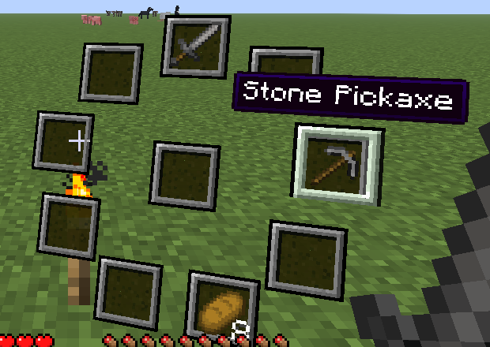

# HandsOn VR: design

Este documento descreve como o HandsOn VR deve se comportar. As issues do GitHub apontam para as seções daqui.

O objetivo é deixar o inventário do Minecraft com cara de jogo nativo de VR: o jogador mexe nos itens com as mãos, sem abrir telas que o deixam parado.

## Resumo

| Recurso | O que é | Exemplo |
|---|---|---|
| Coldres físicos | Ombro direito e os dois quadris guardam qualquer item. | Mão no quadril + grip: pega a picareta. Solta o grip: ela volta. |
| Mochila | Fica no ombro esquerdo e substitui a tela de inventário. | Pega a mochila com o grip, tira o arco com a outra mão, usa e solta. |
| Menu radial | X ou B abre a hotbar em círculo ao redor da mão. | Segura B, leva a mão até a espada, solta B: espada na mão. |
| Regra das mãos | O grip pega emprestado. O radial equipa. | Com a espada equipada, pega o arco com o grip. Ao soltar, a espada volta. |

## Controles (Quest 2)

| Botão | Ação |
|---|---|
| Grip (dedo do meio) | Pegar algo enquanto estiver apertado: item de um coldre, a mochila ou um item da mochila ou do radial. Em qualquer outro lugar, **segura o item da própria mão**. |
| Soltar o grip | Devolve o item ao lugar de onde veio. Se a mão estiver sobre um espaço, coloca a pilha inteira nele. Num coldre, guarda o item ali; no ombro esquerdo, guarda na mochila. |
| Gatilho (indicador), com o grip apertado sobre um espaço | Coloca **um** item no espaço. Na zona de descarte, solta **um** item no chão. |
| B (mão direita) | Enquanto estiver apertado, mostra o menu radial da mão direita. |
| X (mão esquerda) | Enquanto estiver apertado, mostra o menu radial da mão esquerda. |

O B substitui o menu radial do Vivecraft e o X substitui a tela de inventário. Os dois podem voltar ao comportamento original nos ajustes.

Fora dos coldres e da mochila, o grip não troca mais o item da hotbar (o Vivecraft fazia isso): ele segura o item da mão, para levá-lo a um coldre ou à mochila. Isso também pode voltar nos ajustes ("grip troca a hotbar"); com a opção ligada, o grip só segura o item dentro das zonas do corpo.

## Inventário: por que nunca falta espaço

No Minecraft, a mão não guarda nada. Ela só aponta para um espaço:

- a mão direita aponta para o espaço selecionado da hotbar;
- a mão esquerda aponta para o espaço da mão secundária (*offhand*).

Pegar algo com o grip é uma **troca**. O item pego vai para o espaço da mão, e o que estava na mão vai para o lugar de onde ele saiu. Soltar o grip faz a troca de volta.

Como em nenhum momento um espaço fica vazio, isso funciona até com o inventário cheio de terra.

Tudo usa os mesmos pacotes de clique da tela de inventário do Minecraft: trocar com a hotbar (teclas 1 a 9 e F), pegar, colocar e jogar fora. Por isso o mod não precisa estar instalado no servidor.

### Mão vazia

A mão só fica vazia se houver para onde ir:

- **Mão direita:** precisa existir um espaço vazio na hotbar. O mod seleciona esse espaço.
- **Mão esquerda:** o item volta para o espaço de onde o radial o tirou. Se a mão continuar ocupada, o item vai para um espaço vazio do inventário.

Sem espaço livre, a opção "mão vazia" do radial mostra a barreira do jogo e o controle vibra em sinal de "negado".

## 1. Coldres físicos

Os coldres ficam no **ombro direito**, no **quadril direito** e no **quadril esquerdo**. O ombro esquerdo é da mochila.

- **Área de pegar:** cada coldre é um elipsoide no referencial do tronco, e não uma esfera pequena.
  - Ombro: a mão pode estar atrás, ao lado ou acima do ombro, do pescoço até um pouco acima da cabeça.
  - Quadril: a mão pode estar do lado da cintura, um pouco à frente ou atrás.
- **Saída com folga:** a área de saída é maior que a de entrada (histerese), para a vibração não ficar piscando na borda.
- **Tronco:** o tronco só gira quando a cabeça vira além de 35°. Olhar para o lado não leva os coldres junto.
- **Sacar:** mão no coldre + grip. O item vai para a mão. O que estava na mão fica guardado até o grip ser solto.
- **Guardar o item da mão:** feche a mão no item (grip) em qualquer lugar, leve-o até o coldre e solte o grip, como nos jogos de VR. Apertar e soltar o grip com a mão já dentro do coldre também guarda.
  - Se o item estava na hotbar ou na mão esquerda e há espaço livre no inventário principal, ele vai para lá e a mão fica vazia, como a espada na bainha. Sem espaço livre, o item fica onde está, e o coldre lembra dele assim mesmo.
  - Num coldre **ocupado**, o coldre passa a lembrar do item novo. O antigo continua no inventário.
  - Enquanto o grip estiver apertado, nada muda: soltar longe dos coldres deixa o item na mão.
- **Guardar um item pego de outro lugar:** pegue um item da mochila ou do radial com o grip e solte o grip dentro do coldre. O coldre passa a lembrar desse item.
- **Qualquer item:** o coldre lembra o item (id e nome) e o espaço do inventário onde ele está. O item não precisa estar na hotbar.
- **Resposta:** o controle vibra ao entrar num coldre onde o grip faz algo (inclusive com um item seguro, onde soltar o guarda), e o item desenhado no corpo cresce um pouco.

## 2. Mochila (ombro esquerdo)

**Abrir:** qualquer mão no ombro esquerdo + grip. A mochila aparece presa a essa mão, virada para o rosto. Ela some quando o grip é solto.

O item que essa mão segurava (por exemplo, uma tocha) **some** enquanto ela segura a mochila. Essa mão também não ataca nem usa itens nesse tempo.

### Layout

A ideia vem da mochila de *The Walking Dead: Saints & Sinners*, mas o visual é o do **inventário do Minecraft** (ver o [padrão visual](VISUAL.md)). Dentro da borda de lona da mochila há uma janela cinza com relevo, e todos os espaços são quadrados como no jogo (fundo cinza, linha escura em cima e à esquerda, clara embaixo e à direita).

```
┌──────────────────────────────────────┐
│ Fabricação                           │
│ [c][c]            [cap.][peito]      │  crafting 2x2 + resultado
│ [c][c]  ──▶ [r]   [pern][botas]      │  armadura (ícones do jogo)
│                                      │
│        [   ][   ][   ]               │
│        [   ][   ][   ]               │  página 3x3 (espaços maiores)
│        [   ][   ][   ]               │
│                                      │
│  ◀   Página 1/3   ▶         [⤓]      │  páginas + descarte
│      Espaços 5/27                    │
└──────────────────────────────────────┘
```

- **3 páginas de 3x3:** 27 espaços, exatamente o inventário principal do Minecraft. A hotbar fica no radial. Os espaços da página são maiores que os do crafting (cerca de 9 cm), para a mão acertar com folga. Lado a lado, como no jogo, o toque vale no quadrado inteiro.
- **Crafting 2x2:** o mesmo do inventário do jogador, com o título "Fabricação" e a seta cinza do jogo. Ao fechar a mochila, o que sobrou na grade volta para o inventário, como na tela original.
- **Armadura:** capacete, peitoral, calças e botas. O espaço vazio mostra o ícone do próprio jogo.
- **Zona de descarte:** um espaço no canto inferior direito, com uma seta para o chão.
- **Setas de página:** as do livro de receitas do jogo. Elas acendem com a mão em cima.
- **Mão em cima de um espaço:** o espaço clareia, como o cursor no inventário, e o controle vibra.
- **Ícones do jogo:** armadura e setas são lidas das texturas carregadas. Um resource pack que as mude também muda a mochila.
- **Desenho opaco:** o painel é desenhado opaco, inclusive os ícones (pixel a pixel). O translúcido do Minecraft 26 (OIT) mistura camadas a milímetros umas das outras.

### Interação com a outra mão

| Gesto | Resultado |
|---|---|
| Grip sobre um espaço com item | Pega o item: ele fica na mão e pode ser usado na hora. |
| Grip sobre um espaço vazio, o fundo do painel ou o descarte, com um item na mão | Segura o item da própria mão (ele continua na mão). |
| Soltar o item da mão sobre um espaço | Guarda o item ali: num espaço vazio, ocupa; sobre uma pilha igual, junta; sobre outro item, troca (o outro vai para a mão). |
| Soltar o grip sobre outro espaço | Coloca a pilha toda nesse espaço. Pilhas iguais se juntam; diferentes trocam de lugar. |
| Soltar o grip longe da mochila | O item volta para o espaço de onde veio. |
| Gatilho com o grip apertado sobre um espaço | Coloca um item por vez (por exemplo, uma tábua em cada espaço do crafting). |
| Soltar o grip na zona de descarte | Solta a pilha inteira no chão (64 de areia, ou a espada). |
| Gatilho com o grip apertado na zona de descarte | Solta um item por vez. |
| Grip ou gatilho numa seta | Troca de página. |
| Segurar um item sobre uma seta por meio segundo | Troca de página, para levar o item de uma página a outra. |
| Grip no resultado do crafting | Fabrica um e manda para o inventário. |
| Gatilho no resultado do crafting | Fabrica o máximo possível (como Shift + clique). |
| Grip numa peça de armadura ou num item do crafting | Manda de volta para o inventário. |
| Soltar uma peça de armadura no espaço dela | Veste a peça. Se já havia uma, a antiga vai para o lugar de onde a nova saiu. |

A mochila pode ser solta enquanto a outra mão segura um item. O item continua na mão até o grip dessa mão ser solto.

## 3. Menu radial da hotbar (X ou B)

- **Abrir:** segure B para a mão direita ou X para a mão esquerda. O menu abre em volta da mão, virado para o rosto, com a hotbar (9 espaços) em círculo e a **mão vazia** no centro.
- **Acompanha o jogador:** o menu fica preso à área de jogo do Vivecraft. Andar, cair ou virar com o analógico o leva junto. Mexer a cabeça ou se inclinar para alcançar um espaço não o move.
- **Escolher:** passe a mão sobre uma opção. Ela fica destacada e o controle vibra. Ao soltar o botão, o item fica equipado na mão.
- **Mão direita:** seleciona o espaço da hotbar.
- **Mão esquerda:** troca o item da hotbar com a mão secundária. Ao escolher outro item ou a mão vazia, o anterior volta para o espaço dele na hotbar.

### Visual: a hotbar do jogo



O radial segue o [padrão visual](VISUAL.md) com a cara da **hotbar**:

- Cada espaço é uma casa da hotbar do jogo: moldura de pedra e fundo escuro translúcido.
- A **moldura de seleção** da hotbar fica no espaço sob a mão. Sem a mão em cima, ela fica no item que está na mão (como quando você gira a roda do mouse).
- O **nome do item** sob a mão aparece na caixa de dica do jogo, com a cor da raridade.
- O item da **mão esquerda** leva o ícone do escudo no canto, o mesmo do espaço da mão secundária no inventário.
- No centro, a **mão vazia** é uma casa vazia. Sem espaço livre para esvaziar a mão, ela mostra a barreira do jogo.
- A quantidade usa a fonte e a sombra do jogo, como na hotbar.

### Levar um item da mochila para a hotbar

1. Pegue o item na mochila com o grip.
2. Com o grip ainda apertado, abra o radial (X ou B).
3. Passe o item sobre um espaço do radial e solte o grip.

O item vai para aquele espaço da hotbar, e o que estava lá vai para o lugar de onde o item veio.

### Levar um item da hotbar para a mochila

São três jeitos:

- **Por cima do ombro** (como no *Saints & Sinners*): feche a mão no item (grip), leve a mão ao ombro esquerdo e solte. O item vai para a mochila: primeiro junta com pilhas iguais, depois ocupa o primeiro espaço livre. Armaduras não são vestidas. Com a mochila cheia, o controle vibra e o item fica na mão.
- **Com a mochila aberta:** grip num espaço vazio (ou no fundo do painel) com o item na mão, e solte o grip sobre o espaço onde ele deve ficar.
- **Pelo radial:** com o radial aberto, aperte o grip sobre um item do radial para pegá-lo e solte o grip sobre um espaço da mochila.

Apertar o grip no ombro esquerdo **sem** um item seguro abre a mochila. Com um item seguro, soltar ali o guarda.

## 4. Regra das mãos

| Como chegou à mão | O que acontece ao soltar o grip |
|---|---|
| Pelo radial ou pela hotbar | Nada: o item continua na mão (sem grip). |
| Pegado com o grip (coldre, mochila ou radial) | O item volta para o lugar dele e a mão volta a segurar o que tinha antes. |
| O item da própria mão, seguro com o grip | Num coldre, no ombro da mochila ou num espaço, é guardado ali. Em qualquer outro lugar, continua na mão. Trocar de item no analógico com o grip apertado solta o item antigo. |

Exemplo com as duas mãos:

1. A mão esquerda está com uma tocha e a direita com uma espada, as duas equipadas pelo radial.
2. A esquerda pega a mochila: a tocha some.
3. A direita pega o arco da mochila: a espada some e o arco aparece.
4. A esquerda solta a mochila: a mochila some, a tocha volta e o arco continua na mão direita.
5. A direita solta o grip: o arco volta para a mochila e a espada volta para a mão.

## Testes sem VR

O roteiro automático (`./gradlew prodClient`) cria um mundo plano e liga um "VR simulado". O teste posiciona as mãos e aperta grip, gatilho, X e B por código.

Ele confere:

- as zonas dos coldres, inclusive pontos da borda;
- sacar e guardar;
- abrir a mochila, pegar, mover, juntar pilhas, colocar um item, descartar tudo, descartar um, crafting, armadura e páginas;
- o radial: equipar nas duas mãos, mão vazia, mão vazia com o inventário cheio, levar itens da mochila para a hotbar e andar com ele aberto (ele vai junto e a escolha continua funcionando);
- o caso do inventário 100% cheio;
- guardar o item da mão: num espaço da mochila, juntando pilhas, no descarte, por cima do ombro (inclusive com a mochila cheia), num coldre vazio e num ocupado, com a mão esquerda, e soltar longe de tudo.

O resultado vai para `run-prod/handsonvr-selftest.txt`, com prints em `run-prod/screenshots/`.

O `./gradlew prodClientNullVr` liga o Vivecraft de verdade com o "VR nulo" e confere a ligação com os controles: grips, gatilhos, X e B.
