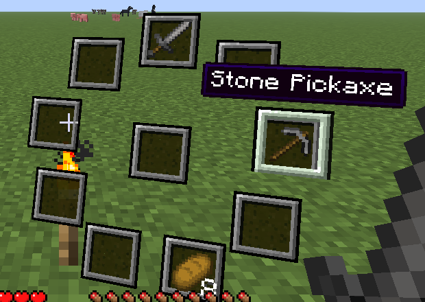

# HandsOn VR: padrão visual

**Regra geral: parecer o Minecraft.** Tudo o que o mod desenha (painéis, menus, ícones, textos) segue o visual do jogo original sempre que possível. **Toda tela ou objeto novo segue este guia.** Quando ele não cobrir um caso, procure primeiro o equivalente no jogo. Invente só se não houver nenhum, e registre a decisão aqui.

## 1. A fonte da verdade são as texturas do jogo

- **Ler o desenho do jogo, não copiar.** Ícones, molduras e fontes vêm das texturas carregadas (`render/Sprite`), por exemplo `Sprite.gui("hud/hotbar_selection")`. Assim, um resource pack que mude a hotbar ou os ícones também muda o mod.
- **Quando não há textura pronta** (a moldura de uma janela, um espaço), usar as cores e medidas exatas da textura do jogo e citar no código de qual textura elas vieram.
- **Sempre ter um substituto.** Se a textura não existir ou tiver um formato inesperado (resource pack em alta resolução, animada), desenhe algo parecido com quadrados e as cores da tabela abaixo. Nunca deixe a tela vazia.

## 2. Pixel art

- Tudo é medido em **pixels do jogo**. Cada tela define quanto vale 1 pixel em metros (mochila: 3 mm; radial: 3,4 mm), e as medidas são múltiplos dele. Exemplos: o espaço do inventário tem 18 px, a casa da hotbar 22 px e o item 16 px.
- **Sem círculos, sem cantos arredondados, sem gradientes suaves, sem sombras borradas.** Só quadrados, linhas de 1 pixel e cantos cortados em 1 pixel, como nas janelas do jogo.
- Ícones são desenhados **pixel a pixel** (`Draw.sprite`). Pixels vizinhos da mesma cor viram um retângulo só.

## 3. Superfícies: escolha pelo uso

| Superfície | Quando usar | Como o jogo desenha | No mod |
|---|---|---|---|
| **Janela** | Painel que a mão segura e manipula | `container/inventory`: fundo `#C6C6C6`, contorno preto de cantos cortados, relevo branco em cima e à esquerda, `#555555` embaixo e à direita | Mochila (`Draw.mcWindow`) |
| **Espaço do inventário** | Dentro de uma janela | `container/slot`: fundo `#8B8B8B`, linha `#373737` em cima e à esquerda, branca embaixo e à direita | Mochila (`Draw.mcSlot`) |
| **HUD** | Menu rápido solto no ar, sobre o mundo | `hud/hotbar`: moldura de pedra, fundo escuro translúcido | Radial (`Sprite.hotbarCell`) |
| **Bloco do mundo** | Um bloco do jogo usado com as mãos | A própria textura do bloco (a grade desenhada em `crafting_table_top`); os itens ficam em cima dele, como no chão ou num suporte | Mesa de trabalho (`table/CraftingTableRenderer`) |

## 4. Estados

| Estado | Padrão do jogo | Onde |
|---|---|---|
| Mão em cima de um espaço (janela) | O espaço clareia (`container/slot_highlight_*`, `#C1C1C1`) | Mochila |
| Mão em cima / selecionado (HUD) | Moldura de seleção da hotbar (`hud/hotbar_selection`, 24x23) | Radial |
| Espaço vazio com função | O ícone do espaço (`container/slot/helmet`, `chestplate`, `leggings`, `boots`) | Armadura da mochila |
| Mão secundária | O ícone do escudo (`container/slot/shield`) | Item da mão esquerda no radial |
| Indisponível | O item barreira | "Mão vazia" sem espaço livre |
| Botão / seta | `recipe_book/page_forward` e `page_backward`, versão `_highlighted` com a mão em cima | Páginas da mochila |
| Nome ou explicação | Caixa de dica do jogo (ver texto) | Item sob a mão no radial |
| Mão em cima de uma casa de um bloco | O realce de espaço do jogo (`container/slot_highlight`): branco translúcido, só no miolo da casa, entre as linhas da textura | Mesa de trabalho |
| Pronto para pegar | Como um item no chão: girando devagar e balançando; com a mão perto, um pouco maior e com o nome na caixa de dica | Resultado da mesa de trabalho |

Em VR, entrar num alvo também vibra o controle. Esse estado não tem equivalente no jogo, só no tato.

## 5. Texto

- **Sempre a fonte do jogo.**
- **Título de janela:** `#404040`, sem sombra (ex.: "Fabricação").
- **Nome de item ou explicação sobre o mundo:** a **caixa de dica** do jogo (`tooltip/background` e `tooltip/frame`), com `Draw.mcTooltip`:
  - fundo `#100010` com os cantos cortados;
  - moldura roxa de 1 pixel, de `#5000FF` em cima a `#28007F` embaixo (já misturadas com o fundo: `#24005B` e `#180033`);
  - texto branco, a 3 pixels da moldura;
  - o nome do item com a cor da raridade (`getStyledHoverName`).
- **Quantidade:** números da fonte de bitmap (`textures/font/ascii.png`), brancos com a sombra `#3F3F3F` um pixel para baixo e para a direita, no canto de baixo à direita do espaço, na posição exata do jogo (`Draw.mcCount`). Na mesa de trabalho, a quantidade de cada casa fica deitada no canto mais perto do jogador, e a do resultado flutuante (o total que o "fabricar tudo" dá) fica à frente dele, virada para o rosto. No resultado do crafting da mochila, o número também é o total.
- **Ícone em vez de texto** sempre que o jogo usa ícone (armadura vazia, mão secundária). Nada de "D", "E", "Cabeça".

## 6. Itens

- O modelo de inventário do item (`ItemDisplayContext.GUI`): 16 px num espaço de 18 (85% do lado), centrado.
- **Achatado na profundidade** (20%): blocos 3D não atravessam o painel nem cobrem a quantidade.
- Itens soltos no corpo (coldres) usam o modelo de item fixo e a luz do lugar, como um item num suporte.
- Itens em cima de um bloco (a grade da mesa) ficam **deitados**, com a luz do lugar: o ícone com a frente para cima e o topo do desenho para longe do jogador; um bloco vira um cubo pequeno apoiado no topo. O que flutua para ser pego usa o modelo de item no chão.

## 7. Cores

Só as cores do jogo. **Proibido:** cores de destaque próprias do mod (os azuis, verdes e amarelos do estilo antigo) e transparências que o jogo não usa.

| Uso | Cor |
|---|---|
| Fundo de janela | `#C6C6C6` |
| Relevo claro / escuro da janela | `#FFFFFF` / `#555555` |
| Contorno | `#000000` |
| Fundo do espaço | `#8B8B8B` |
| Borda funda / clara do espaço | `#373737` / `#FFFFFF` |
| Espaço sob a mão | `#C1C1C1` |
| Título | `#404040` |
| Sombra do texto branco | `#3F3F3F` |
| Caixa de dica: fundo, moldura em cima, moldura embaixo | `#100010`, `#24005B`, `#180033` |
| HUD (hotbar) | Lido da textura |

## 8. Opaco e translúcido no Minecraft 26

O Minecraft 26 desenha o translúcido com OIT (ordem aproximada pela profundidade). Duas camadas translúcidas a milímetros uma da outra se misturam e o desenho "embaralha".

- **No máximo uma camada translúcida por pixel**, e só onde o jogo é translúcido (o fundo da hotbar). Para manter isso, use `Draw.KEEP_ALPHA`.
- Todo o resto é opaco. Cores com alfa `FF` vão sempre pela camada opaca. Um painel inteiro opaco usa `new Draw(..., corDeFundo)`, que mistura as cores semitransparentes com esse fundo.
- **Texto sem a sombra do renderizador** (a sombra é uma segunda camada translúcida). Quando precisar de sombra, como na quantidade, desenhe os glifos pixel a pixel (`Draw.spriteSolid`).
- **Camadas separadas na profundidade:** cerca de 0,4 mm entre elementos do mesmo painel. Os itens ficam à frente, a moldura de seleção depois e a caixa de dica por último.

## 9. Em VR

- **Nada fica solto no mundo.** Um painel fica preso à mão que o segura (mochila), ao corpo (coldres) ou à área de jogo (radial: anda e gira com o jogador, mas não foge quando ele mexe a cabeça). O que é de um bloco fica no próprio bloco (a grade e o resultado da mesa de trabalho).
- **Virado para o rosto** quando abre.
- **Alvos de pelo menos 5 cm**, com folga de 1,5 a 2 cm no toque. O alvo tem o formato do desenho: quadrado.
- **Texto com cerca de 2 cm de altura ou mais**, para ser lido a uns 40 cm.

## 10. Checklist para algo novo

- [ ] Qual é o equivalente no jogo? Qual textura ele usa?
- [ ] O desenho é lido da textura do jogo, com um substituto?
- [ ] As medidas estão em pixels do jogo?
- [ ] Os estados (mão em cima, selecionado, vazio, indisponível) usam os padrões da seção 4?
- [ ] Sem cores próprias, sem círculos, sem texto onde o jogo usa ícone?
- [ ] No máximo uma camada translúcida por pixel?
- [ ] Preso à mão, ao corpo ou à área de jogo, com alvos de 5 cm ou mais?
- [ ] O teste automático tira um print, e ele foi conferido?

## Onde está no código

- `render/Sprite`: lê as texturas do jogo e faz os recortes (a casa da hotbar, os glifos da fonte).
- `render/Draw`: `mcWindow`, `mcSlot`, `mcCount`, `mcTooltip`, `sprite` e `spriteSolid`.
- Exemplos completos: `backpack/BackpackRenderer` (janela) e `radial/RadialRenderer` (HUD) e `table/CraftingTableRenderer` (bloco do mundo).
